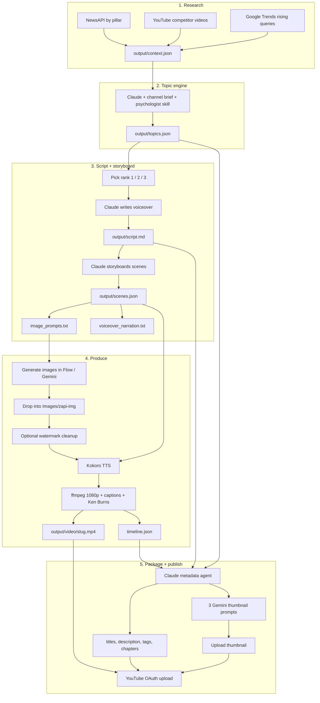

# YouTube Content Orchestration

Local pipeline that takes a faceless YouTube channel from **research → topic → script → storyboard → images → render → SEO → upload**.

Two channel variants live in this repo. Same machinery, different entry points:

| | **Founder Finance** (root) | **Curiosity** (`Youtube-2/`) |
|---|---|---|
| Entry | News + Google Trends + competitor videos | One idea string |
| Look | Black ink stick-men on off-white | Colored doodles; background carries emotion |
| Length | ~10–12 min explainers | ~7–8 min hidden-science essays |
| UI | `npm run ui` → `:4000` | `npm --prefix Youtube-2 run ui` → `:4100` |

Nothing generated (scripts, images, MP4s, metadata) is in git. Clone, add keys, run.

## Orchestration



The Curiosity pipeline skips the research box. `npm run script` in `Youtube-2/` expands `ideas/idea.txt` into a brief, then writes the script and scenes in one go.

The UI is a thin Express wrapper around these same CLI steps. Each card unlocks when the previous step's files exist on disk, so an interrupted run can resume.

## Pipeline steps

1. **Context** (`npm run context`) — pulls high-impact news (6 finance pillars), competitor uploads with ≥20k views, and rising Google Trends queries. Writes `output/context.json` + `output/context.md`.
2. **Topics** (`npm run topics`) — Claude reads that context plus `config/channel.js` and `psychologist-analyst-1.0.0/`, then returns 3 click-engineered video ideas.
3. **Script** (`npm run script`) — Claude writes a 1550–1850 word spoken narration, then a scene JSON: narration chunk, stick-man image prompt, overlay text, mood, Ken Burns move.
4. **Images** — paste `output/image_prompts.txt` into Flow / Nano Banana / Gemini. Name files with the scene number (`07_….jpg` → scene 7). Drop them in `Images/zapi-img/`. Optional: `scripts/clean_images.py` strips visible AI watermarks.
5. **Video** (`scripts/generate_video.py`) — Kokoro TTS sets real scene duration, ffmpeg renders 1920×1080 clips with captions, concatenates, appends `Images/outro.mp4`. Writes `output/video/<slug>.mp4` and `timeline.json`.
6. **Metadata** (`npm run metadata`) — Claude + `skills/thumbnail-seo/` returns 3 thumbnail concepts, 5 titles, SEO description, tags, chapters, pinned comment, A/B plan.
7. **Upload** (`npm run yt:auth` once, then `npm run upload`) — OAuth upload, private by default.

## Repo layout

```
src/                  CLI steps (context, topics, script, metadata, YouTube)
config/               Channel brief, pillars, competitors, visual style
scripts/              Video render, prompt export, watermark cleanup, UI helper
ui/                   Local stepper studio (Express + static HTML)
skills/thumbnail-seo/ Thumbnail / title rules fed to the metadata agent
psychologist-analyst-1.0.0/  Retention psychology skill for topic + script
assets/fonts/         Caption fonts (Anton, Archivo Black, Bebas Neue)
Youtube-2/            Curiosity-channel variant (idea-first, colored doodles)
```

## Setup

**Node 18+**, **ffmpeg**, **Python 3.12** (Kokoro does not run on 3.13+).

```bash
cp .env.example .env          # NEWSAPI_KEY, YOUTUBE_API_KEY, ANTHROPIC_API_KEY
npm install

# Kokoro TTS (used by the renderer)
# python3.12 -m venv ~/.venv/kokoro-py312
# ~/.venv/kokoro-py312/bin/pip install kokoro pillow
```

Optional: `brew install wiltodelta/tap/remove-ai-watermarks` for the image-clean step.

YouTube upload needs a Desktop OAuth client saved as `oauth_client.json` (gitignored). Then `npm run yt:auth`.

## Run

Studio (recommended):

```bash
./scripts/ui.sh start     # http://localhost:4000
# or: npm run ui
```

CLI, same order the UI uses:

```bash
npm run context
npm run topics
npm run script -- --topic=1
python3 scripts/export_image_prompts.py
python3 scripts/export_voiceover_text.py
# generate images externally, drop into Images/zapi-img/
~/.venv/kokoro-py312/bin/python scripts/generate_video.py
npm run metadata
npm run upload -- --check
npm run upload                     # private
```

Curiosity channel:

```bash
# edit Youtube-2/ideas/idea.txt
cd Youtube-2 && cp .env.example .env && npm install
npm run ui                         # http://localhost:4100
```

## Config knobs

| File | What it controls |
|---|---|
| `config/channel.js` | Positioning, audience, USP, title patterns, hard rules |
| `config/pillars.js` | The 6 news pillars + source allow-list |
| `config/competitors.js` | Competitor `@handles` (fix with `npm run resolve`) |
| `config/style.js` | Stick-man prompt prefix + Ken Burns directions |
| `.env` | API keys + NewsAPI / YouTube / Trends tuning |

## What is not in this repo

Keys, OAuth clients, tokens, `node_modules`, generated `output/`, scene images, intro/outro MP4s, and rendered videos. Keep those local.
